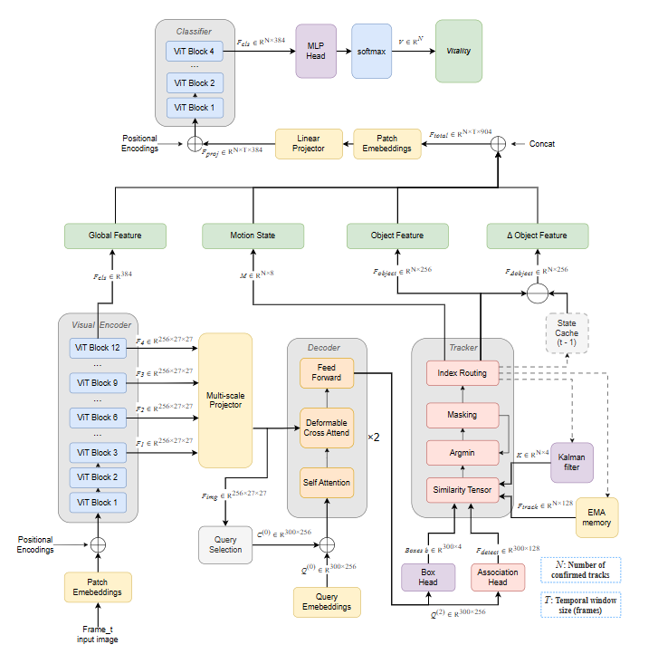
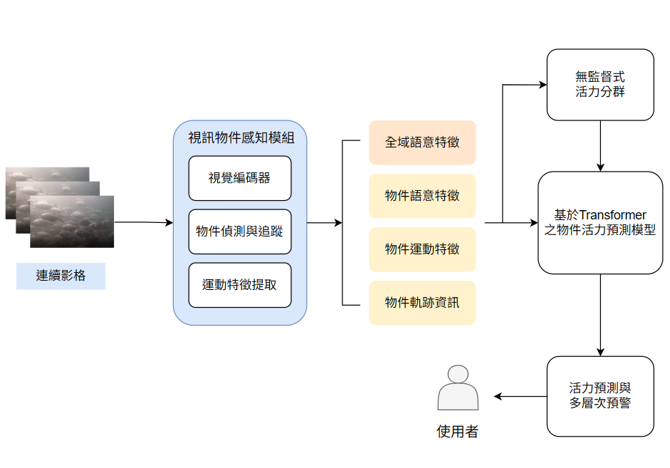
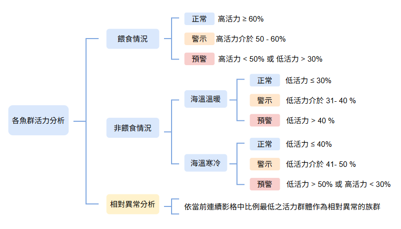
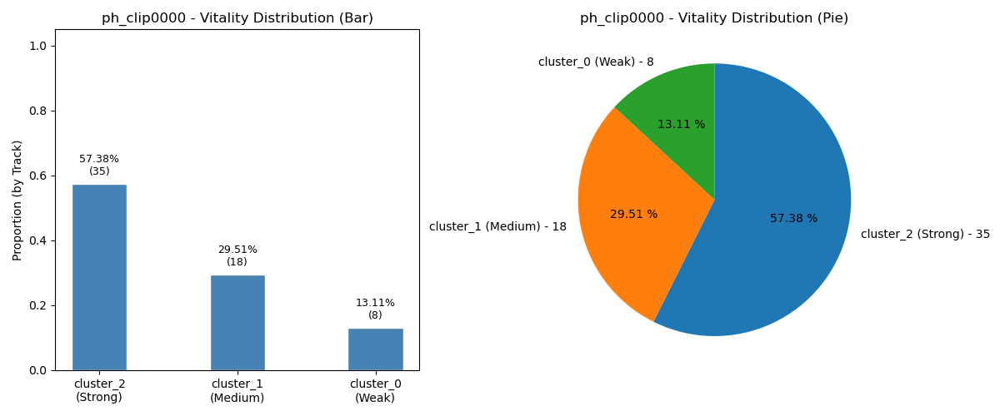
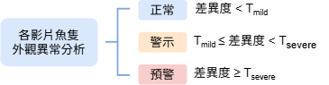
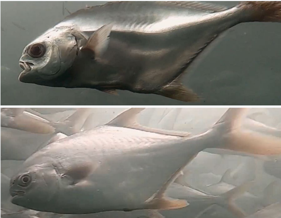
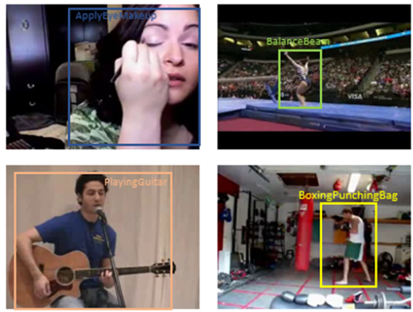

# fish-behavior-monitor

水下魚群個體行為辨識與活力異常即時預警系統。採用以 DINOv2-S/14 為共享骨幹的**統一架構 (unified backbone framework)**，單一凍結模型同時服務偵測、追蹤、行為分類三項下游任務，於單張 GPU 上實現即時推論。

本專案為國立臺灣海洋大學資訊工程研究所碩士論文〈*A Neural Network for Video Object Behavior Detection and Its Application on Underwater Fish School Health Monitoring*〉之公開實作。

> **主要效能數字**
>
> - 魚群活力分類：澎湖海洋箱網 **95.1%**、海大水生中心 **97.0%** window-level accuracy (weighted F1 皆 ≥ 0.95)
> - 多物件追蹤：**51.56 FPS**，較傳統 Hungarian 基線加速 1.25 倍
> - 跨領域驗證：UCF101 **99.4%** (F1 0.99)、JHMDB **92.0%** accuracy (F1 0.91)；總參數量 40M，可訓練 18M

https://github.com/user-attachments/assets/adace363-7aa3-4002-83ad-b4d3b02a8167

---

## 動機

水產養殖業對於魚群健康狀態的即時掌握高度仰賴人工觀察，不僅成本昂貴且判斷主觀。現有自動化系統多在**群體層級**分析行為（平均密度、平均速度、集體游動方向），無法識別**單一個體**的異常狀態；當異常源自少數個體時，群體平均指標會被稀釋，往往等到問題擴大才被察覺。

本系統將問題重新定義為**逐魚隻的時序行為辨識**：對每一條被偵測到的魚，獨立判斷其活力等級（High / Medium / Low），並同時以**同儕外觀差異度 (peer dissimilarity) 排序**識別偏離群體常態的異常個體。前者提供絕對判斷，後者在感測器缺失或缺乏跨場域基準的情境下亦可運作。

---

## 架構總覽

本系統由一個凍結的 DINOv2-S/14 Vision Transformer 作為共享骨幹，單次 forward 的輸出同時供應三項下游任務：物件偵測、個體識別、行為分類。此設計避免傳統多模組系統於每個階段重複計算視覺特徵的開銷，並確保三項任務使用一致的語意表徵。

<p align="center">
  
</p>

系統分為三個主要階段：

1. **視訊物件感知** — 共享骨幹輸出通用視覺特徵，供下游的物件偵測、個體識別關聯頭、物件追蹤共用，一次 forward 完成全部計算
2. **活力分類** — 由追蹤軌跡抽取4項高維時序特徵，GMM 無監督分群建立訓練偽標籤，ViT 分類器輸出活力等級 (High / Medium / Low)
3. **多層次健康預警** — 整合條件式環境閾值、相對式群體分析、個體外觀差異度，產生活力比例預警與同儕外觀預警

<p align="center">
  
</p>

---

## 核心設計

### 共享骨幹網路

傳統視訊理解系統中，偵測、追蹤、動作辨識通常各自使用不同的 backbone，造成計算冗餘。本系統將 DINOv2-S/14 作為單一凍結骨幹，三項下游任務共用其輸出：

- **場景層級特徵** — DINOv2 的 CLS token（384 維）直接作為時序分類器的全域場景輸入
- **物件層級特徵** — RF-DETR decoder 的 query embedding（256 維）同時供應偵測頭與個體識別
- **時序運動特徵** — 相鄰 frame 的 query embedding 差分 $\Delta f_t = f_t - f_{t-1}$ 取代傳統光流

為使 RF-DETR 的 DINOv2 內部表徵可被外部存取，原版骨幹經兩項修改：切換為非 windowed-attention 的純 DINOv2-S/14、新增 CLS token 的對外輸出介面。詳見 [`rfdetr/MODIFICATIONS.md`](rfdetr/MODIFICATIONS.md)。

### 全 GPU 多物件追蹤

傳統 ByteTrack 類追蹤器以 Hungarian 演算法求解二分圖最佳配對。Hungarian 本質為序列式組合最佳化，難以於 GPU 上有效平行化，實務上多將 cost matrix 由 GPU 傳回 CPU 求解，造成跨裝置資料傳輸開銷。

本追蹤器改以 **iterative greedy matching** 取代 Hungarian：將 GPU 上的 cost matrix 攤平排序後貪婪配對。雖然犧牲全域最佳性，但整個配對流程留在 GPU，配合壓縮為 128 維的 ReID 特徵，推論速度達 **51.56 FPS**，較基線（Hungarian + 256 維特徵）的 41.40 FPS 快 1.25 倍。

追蹤器實作見 [`tracker.py`](tracker.py)。

### 學習式個體識別

傳統基於外觀的 ReID 特徵直接使用偵測器的中間層輸出，但該特徵對偵測任務最佳化、未必具備個體區辨能力。本系統在 RF-DETR query embedding 之後接一個 2-layer MLP（Association Head），將 256 維特徵投影到 128 維 metric space，並以 InfoNCE 對比式學習訓練：

同一條追蹤軌跡的兩幀特徵為 positive pair，批次內其他軌跡的特徵為負樣本（in-batch shuffled negatives，類SimCLR / CLIP 訓練方式）。訓練監督來自 SAM 3 產生的高信心度追蹤偽標籤，無須人工逐幀標註身分。

訓練完成後，驗證集 positive–negative margin 從 0.531 收斂至 0.570，證實投影後的 metric space 具備個體區辨能力。詳見 [`association_head.py`](association_head.py) 與 [`train_association_head.py`](train_association_head.py)。

### 語意運動特徵

多數視訊行為辨識仰賴光流（Optical Flow）或 3D 卷積捕捉動作資訊，兩者計算成本皆高。本系統觀察到：既然偵測器已輸出高階語意特徵，相鄰幀之語意特徵差分即可自然表達「物件發生了什麼變化」。

對每條追蹤軌跡的 query embedding 序列 $\{f_t\}$，直接計算：

$$\Delta f_t = f_t - f_{t-1}$$

此 256 維差分向量承載語意層級的動作資訊（例如姿態變化、游動方向轉換），無須任何額外模型。此特徵與全域 CLS、物件 embedding、bbox、bbox 差分共同構成 904 維時序輸入：

```
[0:384]    global_emb      場景級 CLS token
[384:640]  object_emb      物件級 query embedding
[640:896]  query_diff      語意運動特徵 (Δf_t)
[896:900]  bbox            正規化後邊界框 (x, y, w, h)
[900:904]  bbox_diff       邊界框時序差分
```

### 無監督偽標籤

魚隻活力沒有客觀的 ground truth，人工標註又耗時且主觀。本系統以 GMM 於 6 維運動學 + 語意統計特徵（平均速度、總位移、方向變化率、語意差分統計量 qd_mean / qd_std / qd_p95）做自動分群，將每條軌跡歸類至 3 群，再以人工判定每群對應之活力等級。

此設計使訓練資料得以**全自動產出**，部署到新場域時僅需跑一次分群即可建立標籤。詳見 [`build_pseudo_labeled_dataset.py`](build_pseudo_labeled_dataset.py)。

### 多層次健康預警

ViT 輸出的活力分類僅是訊號來源，實際異常判斷由兩種角度整合：

- **活力群體分析** — 當場域具備環境感測資料時，依投餵狀態與海溫查對應閾值表，判斷活力類別佔比是否偏離正常範圍；若環境資料缺失，則退而比較影片當下的活力類別佔比，將佔比最低者標記為相對異常族群
  <p align="center">
  
  </p>
  <p align="center">
  
  </p>
- **個體同儕外觀差異度** — 對同片影片內的個體兩兩計算外觀相似度，與同儕相似度最低者即為相對異常個體。為避免每一片都無差別觸發警示，系統預先以場域歷史資料統計差異度分布，取第 90 與第 99 百分位作為「輕度」與「明顯」兩道警示門檻，確保只有真正偏離場域常態的個體才會被標記，以下展示被明顯預警與正常魚隻之對比圖
  <p align="center">
  
  </p>
  <p align="center">
  
  </p>

詳見 [`peer_anomaly_detection.py`](peer_anomaly_detection.py) 與 [`inference.py`](inference.py)。

---

## 效能表現

### 魚群活力分類

模型於兩組獨立水下場域訓練與測試，皆達到 95% 以上的 window-level 準確率：

| 資料場域 | 總樣本數 | Test set | Accuracy | Weighted F1 |
|---|---:|---:|---:|---:|
| 澎湖海洋箱網（ph2021） | 75,049 | 12,024 | 95.1% | 0.951 |
| 海大水生中心（ntou2022） | 238,486 | 35,981 | 97.0% | 0.97 |

ph2021 場域測試集之各活力等級詳細結果：

| 活力等級 | Precision | Recall | F1-score | Support |
|---|---:|---:|---:|---:|
| Low | 0.96 | 0.97 | 0.97 | 1,531 |
| Medium | 0.92 | 0.91 | 0.92 | 3,541 |
| High | 0.96 | 0.96 | 0.96 | 6,952 |

### 多物件追蹤

| 方法 | 配對演算法 | 執行裝置 | 推論速度 |
|---|---|---|---:|
| Baseline (Hungarian + 256-d ReID) | Hungarian | GPU + CPU | 41.40 FPS |
| **本方法 (Iterative Greedy + 128-d learned ReID)** | **Iterative Greedy** | **GPU only** | **51.56 FPS** |

### 跨領域驗證

為驗證架構通用性，將同一套 pipeline 應用於公開人類動作資料集，通過同樣的物件追蹤及特徵抽取，並以目標人物的行為類別作為標籤訓練模型學習行為分類：

| 資料集 | 類別數 | Accuracy | Weighted F1-score |
|---|---:|---:|---:|
| UCF101 | 101 | 99.4% | 0.99 |
| JHMDB | 21 | 92.0% | 0.91 |

結果證實本架構不侷限於水下場景，可泛化至通用的視訊物件行為辨識任務。
<p align="center">  </p>

---

## 安裝與執行

### 環境需求

- NVIDIA GPU，相容 CUDA 12.4 以上（實測於 RTX 4090 與 RTX 5090）
- Ubuntu 22.04 或 Windows 11 (WSL2)
- Docker 配合 NVIDIA Container Toolkit

### 下載權重

```bash
pip install huggingface_hub

python -c "
from huggingface_hub import snapshot_download
snapshot_download(
    repo_id='SheenaChiu/fish-behavior-monitor',
    local_dir='weights/',
    local_dir_use_symlinks=False
)
"
```

下載後 `weights/` 目錄結構：

```
weights/
├── detector.pth
├── association_head.pth
├── vitality_classifier.pth
└── stats/
    ├── qdiff_stats.npy
    └── bbox_stats.npy
```

### 以 Docker 執行推論

```bash
docker build -t fish-behavior-monitor .

docker run --gpus all --rm \
    -v $(pwd):/workspace \
    fish-behavior-monitor \
    python inference.py \
        --video sample.mp4 \
        --rfdetr_ckpt weights/detector.pth \
        --association_head_ckpt weights/association_head.pth \
        --vit_ckpt weights/vitality_classifier.pth \
        --stats_dir weights/stats \
        --output_dir output/inference \
        --agg_mode per_track
```

輸出：

```
output/inference/
├── predictions_sample_per_track.csv
└── sample_vitality.mp4
```

加 `--render_minority` 可額外輸出僅包含最少數族群魚隻的影片 `sample_minority.mp4`，用於突顯潛在異常個體。

### 非 Docker 安裝（Python 3.12 + CUDA 12.4 以上）

```bash
pip install torch==2.12.0 torchvision==0.27.0 \
    --index-url https://download.pytorch.org/whl/cu130
pip install -r requirements.txt

python inference.py --video sample.mp4 ...
```

---

## 重新訓練

本流程需從原始影片開始重跑整個 pipeline。簡要步驟如下（詳見 [`docs/TRAINING.md`](docs/TRAINING.md)）：

```bash
# 1. RF-DETR 偵測器訓練（需 COCO 格式魚隻標註）
python train_detector.py --dataset_dir output/coco_fish ...

# 2. 以 SAM 3 產生高信心軌跡作為偽標籤
#    (需另行安裝 SAM 3，格式可參考資料集)
#    https://huggingface.co/datasets/SheenaChiu/fish-behavior-pseudo-labels

# 3. 訓練 Association Head
python train_association_head.py \
    --rfdetr_ckpt weights/detector.pth \
    --sam3_csv_dir output/sam3_tracks \
    ...

# 4. 執行完整追蹤產生軌跡 CSV
python build_tracking_data.py ...

# 5. GMM 分群建立偽標籤資料集
python build_pseudo_labeled_dataset.py ...

# 6. 訓練 ViT 活力分類器
python train_vitality_classifier.py
```

---

## 專案結構

```
fish-behavior-monitor/
├── inference.py                      # 推論主入口
├── tracker.py                        # GPU 多物件追蹤器
├── association_head.py               # 個體識別關聯頭與 InfoNCE loss
├── peer_anomaly_detection.py         # 同儕差異度預警
├── predict_vitality.py               # 批次評估腳本
├── build_tracking_data.py            # 追蹤資料產生
├── build_pseudo_labeled_dataset.py   # 偽標籤資料集 (含 GMM 分群)
├── train_detector.py                 # RF-DETR 偵測器訓練
├── train_association_head.py         # Association Head 訓練
├── train_vitality_classifier.py      # ViT 分類器訓練
├── rfdetr/                           # 修改版 RF-DETR
│   ├── MODIFICATIONS.md              # 修改內容與理由
│   └── LICENSE                       # 原版 Apache 2.0 授權
├── requirements.txt                  # 推論依賴
├── requirements-dev.txt              # 訓練依賴
├── Dockerfile                        # 推論用 image
├── Dockerfile.dev                    # 開發用 image
└── README.md
```

---

## 權重與資料集

| 類型 | 內容 | 連結 |
|---|---|---|
| 模型權重 | 偵測器、Association Head、ViT 分類器、推論用 stats | [SheenaChiu/fish-behavior-monitor](https://huggingface.co/SheenaChiu/fish-behavior-monitor) |
| 訓練偽標籤 | SAM 3 產生的高信心魚隻軌跡 CSV | [SheenaChiu/fish-behavior-pseudo-labels](https://huggingface.co/datasets/SheenaChiu/fish-behavior-pseudo-labels) |
| 原始影片 | 於澎湖養殖場及海大水生中心拍攝之水下影像資料集  | 因資料所有權因素未釋出 |

原始影片蒐集自澎湖天和養殖場 (ph2021) 與 海大水生中心 (ntou2022)，因資料所有權因素未釋出。SAM 3 偽標籤 CSV 為軌跡座標標註，單獨使用無法重現訓練；提供下載主要作為格式參考，實際重新訓練仍需配合自有的養殖場影片資料。

---

## 主要相依套件

- **框架** PyTorch 2.12 · Hugging Face Transformers
- **骨幹網路** DINOv2-S/14 (facebook/dinov2-small)
- **偵測器** 修改版 RF-DETR (基於 Roboflow RF-DETR)
- **對比式學習** InfoNCE (SimCLR / CLIP 風格)
- **分群** Gaussian Mixture Model (scikit-learn)
- **部署** Docker + NVIDIA Container Toolkit

---

## 場域部署與 LABEL_MAP

GMM 為無監督分群，cluster 編號在不同隨機種子或不同資料分佈下皆為任意分配。本系統將 cluster-to-vitality 映射設計為可調 config（`LABEL_MAP`），部署到新場域時需跑一次 GMM、查看各 cluster 的特徵分佈（平均速度、語意變化量等），再手動建立對應關係。此設計避免模型綁定特定場域的 cluster 編號慣例，支援跨場域部署。

詳見 [`inference.py`](inference.py) 內 `LABEL_MAP` 註解。

---

## 引用

若本專案對您的研究有所幫助，歡迎引用：

```bibtex
@mastersthesis{chiu2026fishbehavior,
  title   = {A Neural Network for Video Object Behavior Detection and Its 
             Application on Underwater Fish School Health Monitoring},
  author  = {Chiu, Hsin-Yu},
  school  = {National Taiwan Ocean University},
  year    = {2026}
}
```

---

## 聯絡

本專案為個人碩士研究作品。合作、面試或技術問題歡迎來信：

**邱莘瑜 (Hsin-Yu Chiu)** · [sheenachiu.pub@gmail.com](mailto:sheenachiu.pub@gmail.com)

---

## 授權

本專案採用 Apache License 2.0。詳見 [`LICENSE`](LICENSE)。

本專案內含修改版 RF-DETR（`rfdetr/`），原專案同樣採 Apache 2.0 授權，詳見 [`rfdetr/LICENSE`](rfdetr/LICENSE) 與 [`rfdetr/MODIFICATIONS.md`](rfdetr/MODIFICATIONS.md)。

---

## 致謝

本專案的網頁部署介面由合作同學另行開發。感謝指導教授與實驗室夥伴之建議，感謝澎湖天和養殖場與臺灣海洋大學水生中心提供實驗場域與影像資料。本專案採用 Meta AI 的 [DINOv2](https://github.com/facebookresearch/dinov2) 作為骨幹網路；偵測器基於 Roboflow 的 [RF-DETR](https://github.com/roboflow/rf-detr) 修改。
